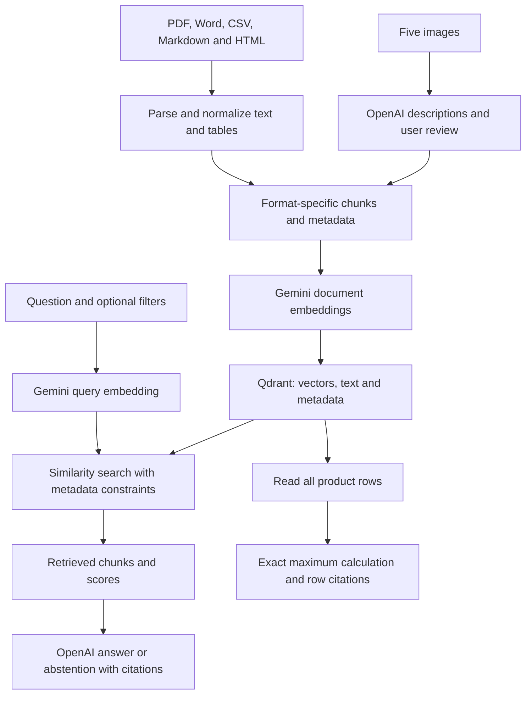

# Multi-Format Data Embedding and Retrieval

A learning application that parses different file formats, converts their useful content into text representations, embeds them with Gemini, stores them together in Qdrant, and retrieves evidence for OpenAI-generated answers.

## Implemented scope

- 10 source files: one PDF, one Word document, one CSV, five images, one Markdown file, and one HTML file.
- 55 stored chunks in one Qdrant collection.
- Gemini `gemini-embedding-2`, using 3,072-dimensional vectors.
- OpenAI `gpt-4.1-mini` for image descriptions and evidence-based answers.
- LangChain document loaders, document objects, splitters, embedding integration, vector-store integration, and chat model integration.
- FastAPI endpoints for search, answers, and exact product maxima.
- Metadata filtering, explicit-filename filtering, citations, and insufficient-evidence responses.
- Repeat ingestion skips unchanged records without embedding calls.

This is a verified learning MVP for the supplied sample dataset, not a general-purpose production ingestion service. CSV was exercised end to end. An XLSX ingestion branch exists but was not exercised in the reported evaluation.

## Architecture and data flow



Images are represented by their reviewed descriptions in this implementation. Image pixels are sent to OpenAI during description generation; Gemini embeds the resulting text. Search and answer generation do not reopen the original files.

The architecture.png dataset image intentionally shows only the simplified local API/database connection. It omits model API calls. The deployment_flow.png image describes a generic Docker workflow; the actual FastAPI application runs directly on Windows.

## Stack and runtime

| Component | Configuration |
|---|---|
| Python | Project virtual environment: `multi` |
| FastAPI | Windows host, `127.0.0.1:8000` |
| Qdrant | Docker image `qdrant/qdrant:v1.19.2`, host port `127.0.0.1:6333` |
| Persistence | Docker named volume |
| Collection | `multi_format_documents` |
| Distance | Cosine |
| Embeddings | `gemini-embedding-2`, 3,072 dimensions |
| Generation | `gpt-4.1-mini` |

The Docker volume preserves database files across container recreation; it is not a backup. Model API credentials and available provider quota/balance are required.

## Folder organization

```text
Multi_Format_Data_Embedding_and_Retrieval/
    data/
        pdf/operations_report.pdf
        word/deployment_guide.docx
        excel/products.csv
        images/architecture.png
        images/deployment_flow.png
        images/sales_chart.png
        images/product_laptop.png
        images/office_workspace.png
        other/support_policy.md
        other/returns_policy.html
    src/
        config.py
        document_utils.py
        pdf_ingestion.py
        word_ingestion.py
        table_ingestion.py
        image_ingestion.py
        other_ingestion.py
        chunking.py
        prepare_chunks.py
        embeddings.py
        generation.py
        vector_store.py
        ingest.py
        retrieval.py
        answers.py
        api_schemas.py
        main.py
        evaluate.py
        check_*.py
    artifacts/
        image_cache/
        all_chunks.json
        evaluation/<run_id>/
            results.json
            summary.json
            review.txt
    requirements.txt
    README.md
```

The root also contains the Docker Compose configuration, `.env`, and `.gitignore`. Keep `.env` out of version control.

## Run the existing project on Windows CMD

```cmd
cd /d E:\Multi_Format_Data_Embedding_and_Retrieval
multi\Scripts\activate
python -m pip install -r requirements.txt
```

For a fresh environment, create it first with `py -3.11 -m venv multi`. The dependency list must include the packages added during development, including `langchain-text-splitters`, `langchain-qdrant`, and `qdrant-client`. The Gemini compatibility adapter was developed with `langchain-google-genai==4.4.0`; dependency upgrades require retesting.

Example `.env` configuration:

```dotenv
APP_NAME="Multi-Format Data Embedding and Retrieval"
APP_ENV=development
QDRANT_URL=http://127.0.0.1:6333
QDRANT_COLLECTION=multi_format_documents
GEMINI_EMBEDDING_MODEL=gemini-embedding-2
GOOGLE_API_KEY=your_google_api_key
OPENAI_API_KEY=your_openai_api_key
OPENAI_MODEL=gpt-4.1-mini
```

Start Docker Desktop, then:

```cmd
docker compose up -d
curl.exe http://127.0.0.1:6333/collections
python -m uvicorn src.main:app --reload --host 127.0.0.1 --port 8000
```

Open [Swagger UI](http://127.0.0.1:8000/docs) and [health](http://127.0.0.1:8000/health).

`/health` confirms that the API is running; it does not test database or model readiness. Use a second activated CMD terminal for checkpoint scripts.

## Parsing, normalization and chunking

| Format | Extraction and representation | Stored chunks |
|---|---|---:|
| PDF | Three pages; narrative separated from table rows | 6 |
| Word | Headings attached to paragraphs; small service table kept complete | 6 |
| CSV | One complete product description per row; typed original values in metadata | 30 |
| Images | One reviewed description per image | 5 |
| Markdown | Heading-aware policy sections | 4 |
| HTML | Remove scripts/styles, preserve headings, convert table cells into labeled sentences | 4 |
| Total | 10 files | 55 |

Narrative splitting uses a 600-character target and 80-character target overlap. Headings are attached to some pieces after splitting. Complete image descriptions and small table representations are kept intact, so 600 is not a universal final-chunk limit. The observed maximum was 1,307 characters.

PDF page 2 originally contained both disconnected table-cell text and a Markdown table. Preparation removed the one verified duplicate sequence and produced three self-contained rows, for example:

```text
Department Training
Department: Engineering; Employees: 18; Training Hours: 144.
```

The duplicate-removal routine intentionally stops if the extraction does not match its supported pattern. It is tailored to this PDF, not arbitrary table layouts.

Useful checkpoint commands, after the datasets are present:

```cmd
python -m src.check_pdf_tables
python -m src.check_word
python -m src.check_table
python -m src.check_images
python -m src.check_other
python -m src.check_pdf_chunks
python -m src.prepare_chunks
python -m src.ingest
```

Image descriptions must be reviewed before approval is recorded. The existing preparation script records the user's approval of the current five descriptions; it must not be reused to approve newly generated descriptions without review. Unchanged image descriptions are read from the local cache. New image-description and embedding requests incur provider usage.

## Record contract and storage

Every chunk has `page_content` plus JSON-compatible `metadata`. Shared fields include `type`, `source`, `source_path`, `content_kind`, `chunk_strategy`, and `chunk_id`. Format-specific fields include page, section, row, row_data, image description, and review status.

Example CSV metadata:

```json
{
  "type": "csv",
  "source": "products.csv",
  "source_path": "excel/products.csv",
  "content_kind": "table_row",
  "row": 2,
  "row_data": {
    "Product_ID": "P001",
    "Product": "Laptop Alpha",
    "Category": "Electronics",
    "Price_INR": 75000.0,
    "Sales_Units": 230,
    "Rating": 4.5
  }
}
```

PDF pages are one-based. CSV row numbering includes the header, so the first product is row 2. Qdrant stores the vector separately from the `page_content` and `metadata` payload fields.

Stable UUIDs derive from source path, source chunk index, and chunk text. Ingestion compares existing payloads and skips exact matches. Observed repeat ingestion: 55 skipped, zero missing, 55 total points, and no embedding requests. Same-ID metadata conflicts raise an error. Source edits that produce new IDs do not automatically remove obsolete records.

## Retrieval and answers

`search(query)` searches the unified collection. Optional filters constrain source type, source path, and page. Higher cosine scores mean closer vector matches; they are not answer-confidence probabilities.

A simple recognizer converts a single explicitly named filename into an exact `metadata.source` filter. Its supported filename stems contain letters, digits, underscores or hyphens. Spaces and additional dots in stems are not supported; use explicit `source_path` for those cases. Metadata matching is case-sensitive. Multiple recognized filenames currently raise an error.

`answer_question()` sends retrieved evidence to OpenAI and requests structured output. It validates citation IDs and builds source references from retrieved metadata. No matches produce a direct abstention without an OpenAI call. Related but insufficient matches should also produce abstention, based on the model's evidence assessment.

Citation-ID validation checks source identity, not the truth of every generated statement. The model can still make unsupported claims, which is why evaluation matters.

`product_maximum()` scrolls through all stored rows of products.csv and calculates maxima using numeric metadata. It returns all tied winners and their source rows. This avoids calculating a dataset-wide maximum from only the most similar chunks.

## API demonstration

Use Swagger UI: select an endpoint, click **Try it out**, paste the JSON, then **Execute**.

### PDF table: POST /search

```json
{"query":"How many training hours did Engineering complete?","k":5,"source_type":"pdf","source_path":"pdf/operations_report.pdf","page":2}
```

Observed: four page-2 results; Engineering ranked first with 144 training hours.

### PDF answer: POST /ask

```json
{"question":"How many support tickets were resolved during the quarter?"}
```

Expected: 420, citing report page 1.

### Word: POST /ask

```json
{"question":"What should I start before running docker compose up -d?"}
```

Expected: Docker Desktop, citing the deployment guide.

### CSV: POST /ask

```json
{"question":"What are the price, sales, and rating of Laptop Alpha?"}
```

Expected: 75000 INR, 230 units, 4.5 out of 5, citing CSV row 2.

### Image: POST /ask

```json
{"question":"What does the product_laptop.png photograph show?"}
```

Expected: the reviewed silver-laptop photograph description, with that image as the source; no catalog identity or price.

### Markdown: POST /ask

```json
{"question":"What are the customer support working hours?"}
```

Expected: Monday–Friday, 9 AM–6 PM IST.

### HTML: POST /ask

```json
{"question":"Who pays return shipping for a defective product?","source_type":"html"}
```

Observed: seller, citing the Return Shipping section.

### Exact calculation: POST /products/maximum

```json
{"field":"Sales_Units"}
```

Observed: Pen Smooth, 1500 units, 30 rows checked, CSV row 28. Using `{"field":"Rating"}` returns Chair Comfort, 4.9, CSV row 18.

### Missing information: POST /ask

```json
{"question":"What information is on page 7 of the report?","source_type":"pdf","source_path":"pdf/operations_report.pdf","page":7}
```

Observed response body: insufficient information, `abstained: true`, and empty citations/retrieved results. HTTP 200 is the designed behavior; the separately supplied page-7 response did not include its HTTP status.

Blank questions, k=0, and unknown calculation fields produced HTTP 422 in API checks. Server processing exceptions return HTTP 500 and are logged. `/ask` does not automatically route arbitrary maximum questions to the calculation endpoint; choose `/products/maximum` explicitly.

## Evaluation: measured results

Run with Qdrant available:

```cmd
python -m src.evaluate
```

This tests application functions directly, not HTTP endpoints. It makes paid model requests and saves a new timestamped folder under `artifacts/evaluation/` containing full results, a summary, and a review sheet. Expected answers are not sent to the model.

| Measurement | Baseline | After filename-filter and prompt fix |
|---|---:|---:|
| Questions completed | 20/20 | 20/20 |
| Request/processing errors | 0 | 0 |
| Cases passing all automatic checks | 19/20 | 20/20 |
| Flagged cases | Q13 | None |

The automatic pass rate increased from 95% to 100% on this particular development set. This is not a general factual-accuracy score or an independent held-out benchmark: the set was reused to verify the fix.

Coverage: three PDF questions, three Word questions, one CSV lookup, two exact calculations, five image questions, two Markdown questions, two HTML questions, and two missing-information questions. Most retrieval cases have no explicit source filters; the missing-page case does. Filename questions now use the application's automatic exact-source constraint. Calculations are explicitly selected, so the evaluation does not measure natural-language routing.

### Q13 failure analysis

Before the fix, “What does the product_laptop.png photograph show?” retrieved catalog information and the model incorrectly identified the photo as Laptop Alpha, including its price, sales, and rating. The expected image evidence was absent.

Two changes addressed different parts of the failure:

1. Retrieval converts an explicit filename into a metadata filter, preventing substitution of unrelated sources.
2. The generation prompt prohibits inferring that a photographed object is a catalog product without explicit supporting evidence.

After the fix, Q13 retrieved and cited `images/product_laptop.png` and described the silver laptop and blue screen. It no longer claimed the catalog identity or price. All 20 automatic checks passed on the rerun.

### Review interpretation

Assistant review of the submitted answers found them consistent with the supplied source representations. Q12 correctly limits “highest sales” to the three products in the chart. Q11 gives the requested Docker sequence; the Windows-host note in the expected reference is supplementary context rather than necessary to answer that sequence question. The two unsupported questions abstain.

For all answered retrieval cases, cited evidence IDs and citation metadata were checked against the retrieved records in the submitted results. Image-specific correctness relies on the image descriptions previously confirmed by the user. The uploaded evaluation files still retain `manual_review: pending`; this README records the assistant review separately and does not claim that those files were edited or that an independent human evaluation occurred.

## Required format analysis

### Which formats were easiest?

CSV and Markdown were easiest for this dataset. CSV had a consistent schema and typed numeric fields; one row naturally formed one product representation. Markdown contained explicit headings and readable text. The simple HTML policy was also manageable after scripts/styles were removed and its table was normalized.

### Which formats were difficult?

PDF required special handling because visual table layout was not preserved reliably in plain text, and table-aware extraction duplicated the table. Images required interpretation and review. Word needed paragraph, heading and table handling so section context was not lost. Difficulty depends on document layout and quality; these results do not imply that every CSV or Word file is easy.

### Why do tables need special handling?

Cells depend on row and column context. The value 144 alone does not identify a department or a measure. Labeled rows preserve that relationship, and numeric metadata supports exact calculations. Generic character splitting can separate headers from values. Merged cells, nested tables and multi-page tables require additional handling beyond this sample.

### Why do images require additional interpretation?

Useful information is visual: components and arrows in diagrams, categories and values in charts, or objects in photographs. Text descriptions make those observations searchable alongside other formats. Descriptions can omit details or invent them; the user reviewed all five before indexing. The Q13 failure also showed that correct descriptions alone do not prevent later retrieval or generation mistakes.

### How does metadata improve retrieval?

Metadata identifies file type and location, enables exact source/page filters, supports citations and debugging, preserves original product values, records image review status, and distinguishes similarly worded sources. The filename filter fixed a failure that semantic similarity alone did not resolve.

### Should all formats use identical chunking?

No. Narrative text benefits from bounded chunks and some overlap. Headings provide context for Word and policies. Product rows must remain complete; image descriptions and small tables can be kept together. Strategies should be tested against actual retrieval needs. Large images' descriptions or large tables would need additional strategies and model-input limits.

## Known limitations and next improvements

- Only a small, fictional development dataset and 20 questions were evaluated.
- PDF table deduplication and page-heading assumptions are specific to the sample layout. Scanned PDFs/OCR, complex tables and arbitrary uploads were not demonstrated.
- XLSX loading exists but has not been verified end to end; the dataset uses CSV.
- Local open-source Unstructured is used for Word extraction, not the paid Unstructured API.
- Image descriptions are indirect representations. Approval must be renewed after description changes.
- Embeddings use a compatibility adapter that overrides an internal LangChain configuration method. Keep its tested version and retest upgrades. The implementation uses synchronous paths.
- Search currently initializes and validates the vector store per call, causing an additional embedding validation request. Connection/model reuse would improve efficiency.
- Unchanged re-ingestion is verified; deletion and synchronization of obsolete source chunks are not implemented.
- Stable IDs do not make metadata edits automatically safe; conflicts stop ingestion.
- Model names can be aliases; identical names do not guarantee immutable provider behavior over time.
- No automatic general question router, reranker, calibrated score threshold, or independent semantic grounding verifier is implemented.
- The API is a local development service without authentication, rate limiting, upload endpoints, or production deployment controls. These were outside this MVP scope.

## Development lessons

Build and check one boundary at a time: configuration, external connections, document contracts, extraction, normalization, chunking, storage, retrieval, calculations, generation, API validation, then evaluation. Keep inspectable intermediate artifacts. Preserve failed evaluation runs, fix the responsible layer, and rerun the same cases to detect regressions. Document observed results separately from assumptions and future capabilities.

## Evaluation question register

| ID | Category | Question | Automatic checks |
|---|---|---|---|
| Q01 | pdf | How many support tickets were resolved during the quarter? | Pass |
| Q02 | pdf | How many employees and training hours did Engineering have? | Pass |
| Q03 | pdf | When are database backups scheduled and how long are they retained? | Pass |
| Q04 | word | What should I start before running docker compose up -d? | Pass |
| Q05 | word | Does the Qdrant Docker named volume count as a backup? | Pass |
| Q06 | word | What should I check if the API cannot reach Qdrant? | Pass |
| Q07 | csv | What are the price, sales, and rating of Laptop Alpha? | Pass |
| Q08 | calculation | Which product has the highest sales across all products? | Pass |
| Q09 | calculation | Which product has the highest rating across all products? | Pass |
| Q10 | image | What does the Local Search Architecture diagram show? | Pass |
| Q11 | image | What sequence does the Docker Application Deployment diagram show? | Pass |
| Q12 | image | In the Product Sales Comparison chart, which of the three displayed products has the highest sales? | Pass |
| Q13 | image | What does the product_laptop.png photograph show? | Pass |
| Q14 | image | What furniture and equipment appear in office_workspace.png? | Pass |
| Q15 | markdown | What are the customer support working hours? | Pass |
| Q16 | markdown | When are unresolved critical issues escalated, and to whom? | Pass |
| Q17 | html | Within how many days of delivery can a product be returned? | Pass |
| Q18 | html | Who pays return shipping when the customer changes their mind? | Pass |
| Q19 | missing_information | What is the CEO's personal phone number? | Pass |
| Q20 | missing_information | What information is on page 7 of the report? | Pass |
